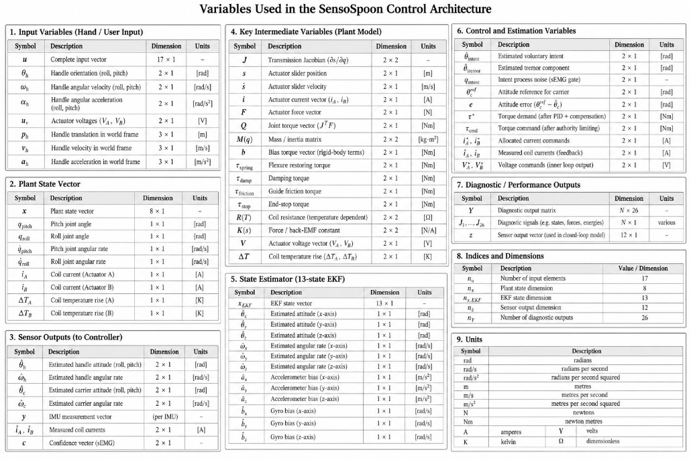

# System Model and Control Design

## A. Mechanism

The device is a self-levelling spoon. A detachable bowl is carried on a two-degree-of-freedom
gimbal — roll and pitch — supported by C-Flex leaf-spring pivots rather than rolling bearings,
so the joint has no backlash and no stiction at the small amplitudes that matter here. Two
Moticont GVCM-016-019-01M voice-coil actuators are grounded to the handle and drive the
carrier through direct spherical-ended pushrods terminating at a common neutral plane. The
nominal joint range is ±15°, and the controller's reference is limited to ±14° so that the
compliant end stops are not used as a working surface.

Two rotational degrees of freedom are the whole of the authority available. The device can
hold the bowl level against the roll and pitch components of hand motion; it cannot cancel
translation, and it cannot cancel arbitrary three-dimensional rotation. This is a deliberate
scope limit rather than an omission, and it bounds every performance figure reported.

## B. Plant Model

The plant is an eight-state continuous electromechanical model, integrated with an implicit
solver. The states are the two joint angles and rates, the two coil currents, and the two coil
temperature rises:

**x** = [ q_pitch, q_roll, q̇_pitch, q̇_roll, i_A, i_B, ΔT_A, ΔT_B ]ᵀ

The model is driven by the hand: a seventeen-element input carrying handle orientation, angular
rate and angular acceleration, the two actuator voltages, and handle translation, velocity and
acceleration in world coordinates. The hand is an *exogenous disturbance*; the controller never
sees its decomposition into voluntary and involuntary parts.

Four couplings define the dynamics.

**Electrical.** Each coil is an RL circuit with back-EMF and a temperature-dependent
resistance:

*L* d*i*/d*t* = *V* − ( *R*(*T*) + *R*_driver ) *i* − *K*(*s*) *ṡ*

**Force and transmission.** Force is *F* = *K*(*s*) *i*, using the same SI constant for force
and back-EMF so that the electromechanical energy balance closes exactly. The linkage is solved
from rod closure rather than prescribed: the assembly branch gives slider position *s*(*q*), the
transmission Jacobian is *J* = ∂*s*/∂*q*, slider velocity is *ṡ* = *J* *q̇*, and the joint torque
is *Q* = *J*ᵀ *F*.

**Mechanical.** The joint dynamics are

*M*(*q*) *q̈* = *Q* − *b*(*q*, *q̇*, base) − τ_spring − τ_damp − τ_friction − τ_stop

where *b* is assembled from rigid-body Newton–Euler terms and includes gravity, moving-base
angular acceleration, centripetal and gyroscopic contributions. Flexure torque and the
compliant end stops are *solved* as forces, not imposed by clipping the integrated state after
the fact — clipping would hide exactly the saturation behaviour the study needs to see.

**Thermal.** Copper loss drives a lumped thermal network giving each coil's temperature rise,
which feeds back into coil resistance.

Fig. 1 shows the complete architecture, from the hand disturbance through the plant and the
sensor models to the two control loops.

**What the model omits.** There is no hysteresis, no creep and no backlash in the flexure, and
friction is a simple guide term. Bearing friction, flexure end constraints, the force-versus-
stroke curve digitisation, the thermal network, battery internal resistance and several custom
mass properties are assumed rather than measured. The model is therefore an
algorithm-development baseline, not a validated digital twin, and it is used to compare
controllers against one another rather than to predict absolute hardware performance.

## C. Sensing

Two Bosch BMI270 inertial units are represented, one on the handle PCB and one on the moving
carrier. Each is sampled at 800 Hz and passed through a sensor model applying a one-sample
output delay, a 100 Hz single-pole filter approximation, quantisation, range saturation,
repeatable noise and a fixed unit-to-unit bias. Attitude is obtained by complementary filtering
that relies principally on the gyroscopes with slow accelerometer correction; the accelerometers
measure specific force including gravity and rotational acceleration, so they do not report tilt
directly and large linear accelerations contaminate the gravity reference.

Coil currents are measured through an independent 12-bit ADC path with its own delay,
quantisation, noise and offset. Startup assumes two seconds of stationary, level dual-IMU
calibration, which averages noisy samples rather than reading model bias constants.

## D. Control Architecture

Control is a two-rate cascade.

**Inner loop — current, 10 kHz.** A PI regulator with resistance and back-EMF feedforward
tracks the commanded coil current, with back-calculation anti-windup on voltage saturation.
Feedforward carries most of the command so the integrator handles only model error.

**Outer loop — attitude, 800 Hz.** A PID law acts on carrier attitude error and measured
angular rate, with mass-matrix, gravity, flexure and guide-friction compensation. The resulting
two-axis torque demand is mapped onto the two coils through the transmission Jacobian by a
bounded least-squares allocator, which enumerates the nine active-constraint cases directly and
so needs no optimisation toolbox at run time.

The design problem is not the servo loop. It is deciding **what attitude to hold**, because two
requirements pull against each other: the bowl must stay level against 4–20 Hz involuntary
motion, and it must *follow* the hand when the user deliberately moves. A filter aggressive
enough to reject tremor also rejects the person.

### 1) Baseline: fixed notch chain

The original controller estimates intent by passing handle attitude through a fixed IIR chain —
five notches at 4, 6, 8, 10 and 12 Hz with a 7 Hz bandwidth parameter, followed by bounded
phase-lead compensation and a second-order 10 Hz low-pass. Coefficients are computed before
startup and the run-time path is a fixed recurrence with no online frequency search. It is
simple, cheap and robust, and its weakness is structural: a fixed band cannot distinguish a
slow voluntary movement from a low-frequency tremor, because the two overlap spectrally.

### 2) Intent/tremor separation by extended Kalman filter

The delivered controller replaces the filter with a thirteen-state EKF that estimates the
voluntary and involuntary components *separately* rather than filtering a fixed band. The state
is

**x** = [ θ_ix, θ̇_ix, θ_iy, θ̇_iy, a₁ₓ, b₁ₓ, a₂ₓ, b₂ₓ, a₁ᵧ, b₁ᵧ, a₂ᵧ, b₂ᵧ, ω ]ᵀ

where θ_i is voluntary (intent) angle per axis on a constant-velocity model, (a₁, b₁) and
(a₂, b₂) are the quadrature amplitudes of the tremor fundamental and its second harmonic, and ω
is the *shared* tremor frequency, estimated rather than gridded. Estimating ω is what allows an
out-of-band 20 Hz disturbance to be tracked at all; a fixed 4–12 Hz basis cannot represent it.

The measurement is deliberately weak — the IMU sees only the sum:

*y* = θ_i + a₁ + a₂  (per axis)

This is the structural difficulty the design turns on. Because intent and tremor need only
*add up* to the measurement, the filter's own consistency statistic stays healthy while the
decomposition is wrong, and tremor that the single-frequency model cannot place is absorbed into
the flexible intent state and passed to the spoon as though the user had meant it. No amount of
watching the IMU detects this, because the IMU only ever sees the sum.

### 3) sEMG intent gate

The remedy is a second sensor that observes the *cause* rather than the effect. Surface
electromyography from an agonist/antagonist forearm pair is sampled at 4 kHz, band-passed over
20–450 Hz, rectified and enveloped. The gate takes the *signed difference* of the pair — a
reciprocally activated pair carries net joint torque in its difference, whereas the sum is
dominated by a co-contraction floor that rises with tremor as well as with effort — and maps its
magnitude to a voluntary-drive confidence in [0, 1] per axis.

That confidence multiplies the intent process noise in the EKF, i.e. it sets the estimator's
licence to attribute motion to intent. It does nothing else: the states, the measurement model
and the IMU-only view of attitude are unchanged.

What is deliberately *not* done is to estimate a voluntary angle from muscle and feed it in as a
pseudo-measurement. That was built and rejected on measurement — the estimate correlates well
(*r* = 0.95–0.98) but carries 1.6–1.8° of error, while the effect being removed is 0.02–0.18°,
so it would have injected an order of magnitude more error than it removed.

The gate runs at two speeds. A slow path (1 Hz corner, ≈225 ms group delay) is clean enough to
*close* the gate; a fast path (4 Hz corner, ≈56 ms) may only ever *open* it, the two being
combined with a maximum. The asymmetry is the point: wrongly closing the gate suppresses the
user's movement, whereas wrongly opening it merely reverts to the previous behaviour, so the two
errors are not treated equally. The premise that makes this possible at all is the 30–50 ms
electromechanical delay — muscle activity precedes limb motion — taken from the literature and
not measured here.

### 4) Predictive authority limiter

A supervisory limiter derates control authority when the tremor correction predicted over the
next 20 ms would exceed either the coil current limit or the mechanism's joint travel. It
applies an 85 % margin, ramps authority at 5 s⁻¹ rather than switching, and uses an
inverse-dynamics estimate of the current a demand would require. Its purpose is to fail
gracefully into reduced suppression instead of into saturation or end-stop contact.

## E. Principal Parameters

**TABLE I. PLANT AND ACTUATOR**

| Quantity | Value |
|---|---|
| Degrees of freedom | 2 (roll, pitch) |
| Joint range / reference limit | ±15° / ±14° |
| Actuator | 2 × Moticont GVCM-016-019-01M voice coil |
| Force constant *K* | 1.5 N/A (nominal) |
| Coil resistance / inductance | 4.6 Ω / 0.8 mH |
| Bus voltage | 7.4 V (2S LiPo) |
| Current limit | 1.5 A |
| Continuous copper power | 4.4 W |
| Actuator stroke | ±6.35 mm |
| Shaft side-load limit | 2.2 N |
| Nominal payload | 5 g at the bowl |

**TABLE II. CONTROLLER**

| Quantity | Value |
|---|---|
| Current loop | 10 kHz PI, *k*_p 0.8, *k*_i 2000, anti-windup 1500 |
| Attitude loop | 800 Hz PID, natural frequency 35 Hz, damping 0.85 |
| IMU sampling | 800 Hz, 100 Hz single-pole, one-sample delay |
| Baseline intent filter | notches at 4/6/8/10/12 Hz, 7 Hz bandwidth, 10 Hz low-pass |
| EKF states | 13 (intent ×4, tremor ×8, shared ω) |
| EKF process noise | *q*_intent 10⁻⁴, *q*_tremor 10⁻⁵, *q*_ω 2 × 10⁻² |
| EKF measurement noise | (0.02°)² |
| Tremor frequency search | 2–25 Hz, initialised at 6 Hz |
| sEMG sampling / band | 4 kHz / 20–450 Hz |
| Gate slow / fast corner | 1 Hz / 4 Hz |
| Electromechanical delay assumed | 40 ms |
| Authority horizon / margin / rate | 20 ms / 85 % / 5 s⁻¹ |

All parameters are centralised in `src/control/rcflex_control_parameters.m` and
`src/model/rcflex_parameters.m`; the algorithm in use is selected by a single field, so the
baseline and the delivered controller can be exchanged without editing anything else.
